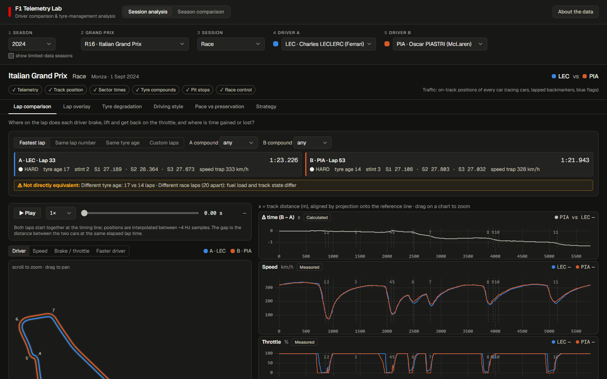
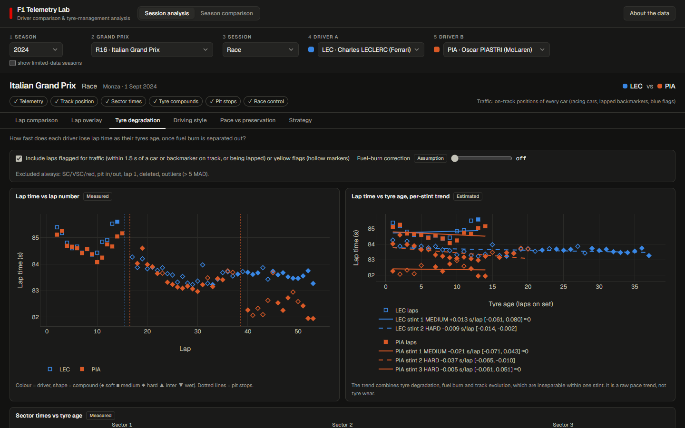
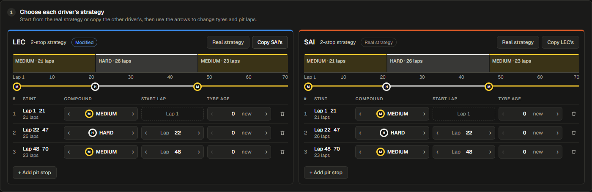
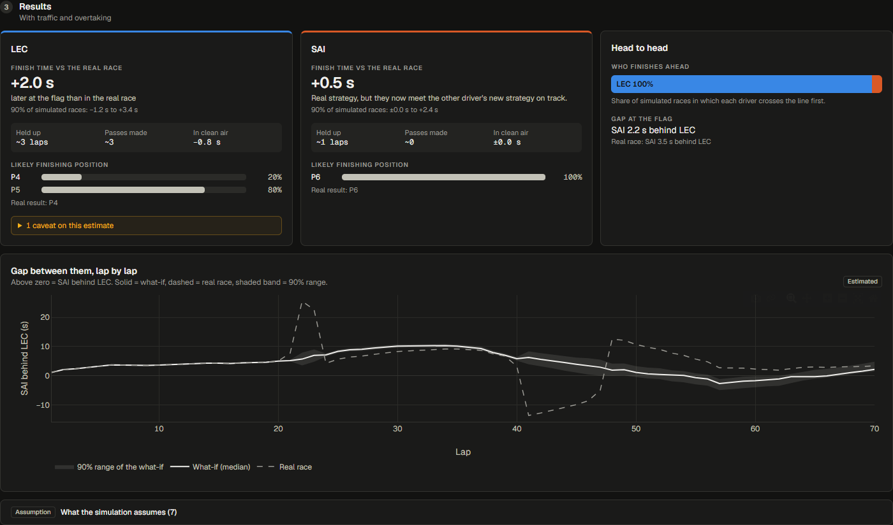
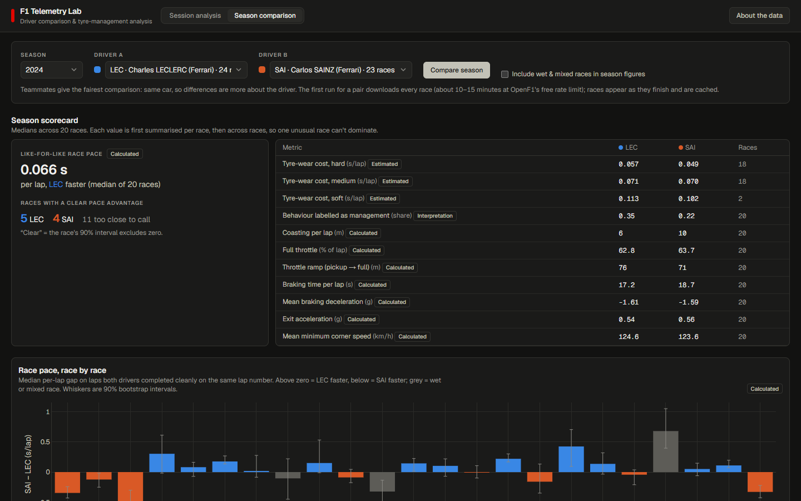

# F1 Telemetry Lab

A local engineering tool for comparing two Formula 1 drivers in historical sessions: where on the lap they gain or
lose time, how they brake, lift and get back on the throttle, how quickly their tyres degrade, whether they look like
they are managing tyres or losing grip, and how a different pit strategy would probably have played out.

It covers **2023 to the present with full telemetry** (from [OpenF1](https://openf1.org)) and **2019–2022 with lap
times and pit stops** (from [Jolpica-F1](https://github.com/jolpica/jolpica-f1)). Every number on screen is labelled
with how it was obtained (measured, calculated, estimated, interpretation or assumption), and the app never presents
an estimate as tyre wear or grip.



## Contents

- [Features](#features)
- [Getting started](#getting-started)
- [How it works](#how-it-works)
- [Technical decisions](#technical-decisions)
- [Project structure](#project-structure)
- [API](#api)
- [Testing and validation](#testing-and-validation)
- [Limitations](#limitations)
- [Project history](#project-history)
- [Further documentation](#further-documentation)

## Features

### Session analysis

Pick a season, Grand Prix, session (race, sprint, qualifying or practice) and two drivers. Tabs that a session
can't support (for example tyre-age trends in qualifying, or anything needing telemetry before 2023) are disabled
with the reason shown.

| Tab | Question it answers | What's in it |
|-----|---------------------|--------------|
| **Lap comparison** | Where on the lap does each driver brake, lift and get back on the throttle, and where is time gained or lost? | Track map (driver, speed, inputs or faster-driver colouring, corner zoom), synced telemetry stack (Δtime, speed, throttle, brake, gear, acceleration), animated time-based replay, corner-by-corner table with resolution-aware brake-point differences. Four lap-pairing modes: fastest, same lap, same tyre age, custom, with a "not directly equivalent" banner when the laps differ in compound, tyre age, fuel or traffic. |
| **Lap overlay** | How does a driver's behaviour change between laps (fresh vs worn tyres)? | Up to four laps per driver overlaid, Δtime against the first lap, brake-point table. |
| **Tyre degradation** | How fast does each driver lose lap time as their tyres age, once fuel burn is separated out? | Per-stint robust trends (Model A) and a session-wide regression (Model B) with per-driver, per-compound tyre-age costs and confidence intervals; sector trends; a fuel-correction slider shown explicitly as an assumption; whole-field long runs in practice. |
| **Driving style** | How do the two drivers differ in throttle, braking, coasting and corner speed across all clean laps? | Twelve per-lap metrics shown as distributions, plus an experimental line-length proxy per corner. |
| **Pace vs preservation** | As tyres age, does a driver look like they are choosing to manage them, or losing grip? | Pattern matrix per corner zone (management / grip loss / mixed / no clear pattern) with the supporting evidence, indicator-vs-tyre-age explorer, time cost per zone, and the confounders that could explain each trend. |
| **Strategy** | How did stints, pit stops and undercuts shape the gap between them, and what if they'd done it differently? | Field stint timeline, gap and running position, pit-stop losses, undercut/overcut cycles, cross-compound pace curves, and the **what-if strategy simulator**. |



### What-if strategy simulator

Change either driver's pit stops and tyres and see how the race would probably have ended. You build a strategy per
driver on a stint timeline (arrows change the compound, the lap of each stop and the age of the set), optionally add
a safety car or VSC, choose whether the real field can get in the way, and run 2,000 simulated races.



Results show the finish-time difference against the real race with a 90% range, the likely finishing position, how
often each driver finishes ahead, laps spent held up and passes made, and the gap lap by lap against what really
happened. A best-strategy finder ranks every 1-, 2- or 3-stop plan for a driver. Every result carries its caveats:
extrapolating tyres beyond what anyone ran that day, or a gain that comes mostly from unvalidated compound offsets.



### Season comparison

Choose a season and two driver codes (teammates give the fairest comparison). A background job analyses every Grand
Prix with the same methods as the session view and summarises the season: like-for-like race pace, races with a
clear pace advantage, tyre-wear cost per compound, driving-style medians and behaviour patterns, race by race, with
a link into each race. Wet and mixed races are classified and left out of season figures by default.



## Getting started

### Prerequisites

- Python 3.13
- Node.js 22 or newer (developed on Node 26)
- Internet access for the first load of each session (data is cached afterwards)

### Install and run

```bash
# Backend: FastAPI on http://localhost:8000 (interactive docs at /docs)
cd backend
python -m venv .venv
.venv/Scripts/python -m pip install -r requirements.txt     # macOS/Linux: .venv/bin/python
.venv/Scripts/python -m uvicorn app.main:app --reload --port 8000

# Frontend: Next.js on http://localhost:3000
cd frontend
npm install
npm run dev
```

Open http://localhost:3000 and press **Load example** (2024 Italian Grand Prix, Leclerc vs Piastri), or pick any
session.

- The frontend calls `/api/...` on its own origin, and Next.js proxies those requests to the backend on port 8000.
  Forwarding port 3000 alone is therefore enough to use the app from another machine. Set `NEXT_PUBLIC_API_BASE` to
  call a backend elsewhere directly.
- Downloaded data is cached under `data/` (gitignored). Deleting it is safe: everything can be downloaded again.
- First loads are slow because of OpenF1's free rate limit (30 requests per minute); after that, sessions load from
  the cache. A whole season comparison takes 10–15 minutes the first time and is cached per race.

## How it works

```
Browser (Next.js, React)                         FastAPI backend
┌──────────────────────────┐   /api (proxy)   ┌─────────────────────────────────────────────────────┐
│ Selection → tabs          │ ───────────────▶ │ api/routes.py                                        │
│ TanStack Query (fetching) │                  │   ↓                                                  │
│ Zustand (shared cursor)   │                  │ sources/  OpenF1 · Jolpica · MultiViewer             │
│ uPlot · Plotly · Canvas   │                  │   (rate-limited HTTP + raw disk cache)               │
└──────────────────────────┘                  │   ↓ normalized DataFrames                            │
                                              │ processing/  laps, flags, traffic, reference line,   │
                                              │              alignment, season jobs → Parquet cache  │
                                              │   ↓                                                  │
                                              │ analysis/  corners, style, degradation, models,      │
                                              │            preservation, strategy, simulator → JSON  │
                                              └─────────────────────────────────────────────────────┘
```

1. **Catalog and capabilities.** A registry picks the data source per season and computes what each session supports
   (telemetry, positions, sectors, compounds, pit stops, race control, intervals). The UI enables features from those
   capabilities instead of from hardcoded years.
2. **Lap table.** Laps are normalized across sources, given compound and tyre age from stints, and flagged: pit in/out,
   lap 1, SC/VSC/red flag (reconstructed from race-control messages), deleted, traffic, and statistical outliers. Every
   excluded lap keeps its reason.
3. **Alignment.** Each lap is projected onto a reference line (the session's fastest clean lap), so every comparison
   happens at the same track distance, resampled to a 5 m grid.
4. **Analysis.** Pure functions over DataFrames produce corner metrics, style metrics, degradation models, preservation
   patterns, strategy summaries and simulations. Each response carries the evidence tier of every metric.
5. **Caching.** Raw responses, Parquet telemetry, in-memory memoisation, and per-race season summaries mean each piece of
   historical data is downloaded once.

## Technical decisions

The reasoning behind the main choices. Fuller detail is in the [docs](#further-documentation).

### Data

| Decision | Why |
|----------|-----|
| **No FastF1; OpenF1 for 2023+, Jolpica for 2019–2022** | Since mid-October 2026, F1's live-timing archive (which FastF1 reads) requires a paid F1 TV login, and its terms forbid rehosting. OpenF1 is free and carries the same feed (car data ≈ 3.7 Hz, positions ≈ 4 Hz) from 2023. Jolpica (the Ergast successor) fills 2019–2022 with lap times and pit stops only. The source adapters leave room to add FastF1 later. |
| **MultiViewer for corner positions** | Its corner coordinates use exactly the same frame as OpenF1 positions. It's unofficial, so it is optional enrichment: when corners don't match the layout, the app falls back to corners detected from speed minima. |
| **Capabilities computed at runtime** | What a session supports depends on the source and the session type, not just the year. Features are enabled or disabled from the computed capabilities, with the reason shown. |
| **Fetch per driver, per whole session, once** | OpenF1 allows 3 requests per second and 30 per minute. Fetching a full session per driver (2 requests) and caching it beats fetching per lap. All HTTP goes through one rate-limited client with a raw on-disk cache. |
| **DuckDB + Parquet instead of PostgreSQL** | It's a local, single-user tool over immutable historical data read in column slices. No database server to run. Season aggregates are DuckDB queries over per-race Parquet files. A storage interface leaves room for a server database if the app is ever hosted. |

### Measuring what the data can actually support

| Decision | Why |
|----------|-----|
| **Align laps on track distance by projection, not by integrating speed** | Timestamps aren't comparable between laps, and integrating speed drifts. Every position sample is projected onto the reference line (KD-tree plus segment projection) to get its distance along the lap, so every lap shares the same corner positions. Elapsed time combines speed integration with a 400 m low-pass correction to position timing: local noise ≈ 0.006 s, end-of-lap delta within ~0.02 s of official. |
| **"Racing line" means longitudinal behaviour** | OpenF1 positions are map-matched to a single track line: at the 2024 Monza start, 20 cars on a staggered grid sat within ±0.2 m of one line. Lateral line choice is therefore not measurable from public data, so the app compares where braking, lifting, throttle pickup and minimum speed happen along the lap. An experimental line-length proxy (wheel-speed distance minus track distance) is shown separately and labelled as such. |
| **Braking intensity from deceleration, not the brake channel** | The brake channel is on/off only. Intensity is computed from speed. Car-data timestamps jitter, so acceleration uses a 7-sample local quadratic fit, and braking intensity uses mean deceleration over the brake application, which is robust to jitter. |
| **Show the resolution on every braking-point metric** | At ~4 Hz a sample is ~20 m apart at 300 km/h. Brake onset is interpolated between samples with a ± of half the local spacing, and differences smaller than that are shown as "not resolvable". |
| **Corner zones shared by every lap** | Zones come from speed minima on the reference lap and are labelled with the corners inside them, so time-in-zone always compares identical stretches of track. Flat-out corners get their own zones. |
| **Traffic from every car's position** | A lap is flagged (not dropped) when the car is within 1.5 s of a car physically ahead, including lapped backmarkers and being lapped. This uses every car's on-track position. Validated against the official blue-flag log at Monza, Monaco and Suzuka 2024: 96–100% recall and 95–100% precision. |

### Statistics and models

| Decision | Why |
|----------|-----|
| **Two degradation models** | Within one stint, tyre age and lap number rise together, so fuel burn and track evolution can't be separated from tyre wear. Model A (per-stint Theil–Sen trend with a 90% CI) is therefore labelled a *raw pace trend*. Model B is a session-wide regression (statsmodels OLS, HC3 errors) with driver and compound effects; it separates them because tyre age resets at pit stops while lap number doesn't. On 2024 Monza its lap effect, −0.056 s/lap, matches the published fuel-burn effect (~0.05–0.06). |
| **Management vs grip loss is a rule-based interpretation** | Worn tyres *force* lower corner speeds; management is a *choice* to lift, coast or feed in the throttle while corner speed holds. A trend only counts when its 90% CI excludes zero **and** the change across the stint exceeds the measurement resolution. Braking earlier alone is not counted, because grip loss causes it too. Labels are shown as interpretations, alongside the confounders. |
| **Simulator anchored to the real race** | A what-if's crossing time = real crossing time + (simulated plan − simulated real strategy). The real strategy therefore reproduces the real race exactly, and only the modelled difference carries uncertainty. |
| **Simulator lap-time model** | Driver-specific tyre slopes are ridge-shrunk toward the field slope so short stints can't produce wild slopes. A quadratic term is kept only when AIC improves. Compounds with fewer than 3 drivers, fewer than 40 clean laps or a negative slope are flagged and excluded from the optimiser. Uncertainty comes from 2,000 Monte Carlo draws of coefficients, lap noise and pit loss, with strategies compared on the same draws. Backtest over all 2024 dry races: median error 0.71 s per driver per race. |
| **Traffic and overtaking fitted per race** | Each race's close battles (cars within 1 s) fit a pass-probability curve with a weak prior. A Monaco-like race gets a very different curve from Bahrain: about 2.5 s/lap of extra pace is needed for a 50% pass at Monaco, against 0.7 s in Bahrain. The optimiser ranks in clean air first, then re-ranks its shortlist with traffic. |
| **A cross-race degradation prior was tested and not adopted** | Predicting a compound's degradation from other races gained only ~0.004 s/lap over the compound average, and fitted compound offsets turned out to be unpredictable and inconsistent with practice pace. Instead, every simulated plan reports how much of its gain comes from those offsets, and it is flagged when they supply most of it. |
| **Wet races handled explicitly** | Tyre-age models can't separate wear from a drying track. Races are classified dry, mixed or wet from rainfall and wet-tyre use; models warn on mixed or wet races, and season figures use dry races by default. |

### Presentation and honesty

| Decision | Why |
|----------|-----|
| **Evidence tier on every metric** | Measured, Calculated, Estimated, Interpretation or Assumption, shown as a badge with a hover note. Nothing is presented as tyre wear, grip, tyre temperature or "% tyre life", because no public source measures them. |
| **No generated text explanations** | The app shows visualisations and measured or calculated metrics only. Labels and captions are fixed templates, so nothing reads as an explanation the data can't back. |
| **Colour follows the driver slot, not the team** | Teammates share a team colour, so driver A is always blue (`#3987e5`) and driver B always orange (`#d95926`). The pair was checked for colour-vision deficiency on the chart background. Speed uses a single-hue ramp; tyre compounds use the conventional compound colours, always with the compound name. |
| **uPlot for telemetry, Plotly for analysis, Canvas for the map** | Six synced telemetry charts need a fast shared cursor (uPlot, ~50 KB). Statistical charts need fits, interval bands and box plots (Plotly, loaded on demand). The track map draws a few thousand points per lap and animates the replay, so Canvas 2D with d3-zoom is enough. |
| **Client-side state** | TanStack Query handles fetching and caching. Zustand holds the shared cursor distance that links the map, charts and corner table, plus the current view. |

## Project structure

```
backend/
  app/
    main.py             FastAPI app
    config.py           paths, rate limits, constants
    api/routes.py       all HTTP endpoints
    sources/            OpenF1, Jolpica and MultiViewer adapters, rate-limited HTTP client, source registry
    storage/            raw response cache and Parquet store
    processing/         lap table, track status, traffic, reference line and alignment, comparisons,
                        season jobs, cross-race priors, session-level memoisation
    analysis/           corners, style, line length, degradation (Model A), model (Model B), preservation,
                        strategy, race model, simulator, traffic simulation, degradation prior
  tests/                offline unit tests (pytest)
frontend/
  src/app/              page, layout, global styles and colour tokens
  src/components/       one component per view (TrackMap, TelemetryStack, StrategySimulator, SeasonView, …)
  src/lib/              typed API client, colours, Zustand store
  e2e/                  Playwright end-to-end tests
docs/                   data sources, architecture, methodology, limitations, screenshots
data/                   (gitignored) caches: raw/, parquet/, season/, priors/
```

## API

All endpoints are under `/api`; interactive documentation is at http://localhost:8000/docs. Session ids look like
`of-<OpenF1 session key>` or `jp-<year>-<round>-<R|Q|S>`.

| Endpoint | Returns |
|----------|---------|
| `GET /seasons`, `/seasons/{year}/events` | Catalog of seasons, Grands Prix and sessions |
| `GET /sessions/{id}` | Session metadata, capabilities and drivers |
| `GET /sessions/{id}/laps`, `/stints`, `/track` | Lap table with flags, stints, reference line with corners and zones |
| `GET /sessions/{id}/trace`, `/compare`, `/corners` | Distance-aligned lap traces, lap pairing with comparability notes, per-zone corner metrics |
| `GET /sessions/{id}/degradation`, `/model`, `/longruns` | Model A trends, Model B fit, practice long runs |
| `GET /sessions/{id}/style`, `/preservation`, `/line` | Style metrics, preservation patterns, line-length proxy |
| `GET /sessions/{id}/strategy`, `/traffic` | Strategy summary; on-track traffic (background job, polled) |
| `GET /sessions/{id}/whatif/model` | Simulator model, backtest and real strategies |
| `POST /sessions/{id}/whatif/simulate`, `/whatif/optimise` | Simulate plans; rank the best plans for a driver |
| `GET /seasons/{year}/drivers`, `/seasons/{year}/compare` | Season driver list; season comparison (background job, polled) |

## Testing and validation

```bash
cd backend && .venv/Scripts/python -m pytest -q     # 40 offline unit tests
cd frontend && npx tsc --noEmit && npx eslint src    # type-check and lint
cd frontend && npx playwright test                   # 7 end-to-end tests on installed Microsoft Edge
```

The end-to-end tests run against the real backend and cached real data (2024 Monza, 2025 Hungary), and start both
servers if they aren't running. On a fresh machine the first run downloads that data.

Methods were checked against independent references wherever one exists:

- Trace lap times within ~0.1 s of official on Monza, Monaco, Suzuka, Las Vegas and the Austria sprint (2024),
  2023 Monza and Australia, and 2026 São Paulo; the end-of-lap delta between two drivers within ~0.02 s of the
  official difference (2024 Monza).
- Model B's fuel-and-track effect matches published fuel-burn figures (2024 Monza).
- Traffic detection matches the official blue-flag log (see above).
- The simulator backtest reproduces every driver's real 2024 dry-race result to a median 0.71 s (0.36 s in races
  without a safety car).
- The overtaking curves order circuits as expected: Bahrain easiest, Monaco hardest.

## Limitations

The full list, with causes, is in [docs/LIMITATIONS.md](docs/LIMITATIONS.md). The most important:

- **2019–2022 has no telemetry, positions, sectors or compounds**: those seasons support lap times, degradation trends
  and strategy only, and tyre age is inferred from pit stops.
- **Lateral racing lines aren't measurable** from public data (positions are map-matched).
- **~4 Hz sampling and an on/off brake channel** limit braking-point precision to ±7–20 m and hide brake pressure.
- **No public source has** tyre temperature, pressure or wear, fuel load, ERS state, steering or set-up, so anything
  about them is estimated or assumed, and labelled that way.
- **2026 cars** have no DRS, and energy management strongly affects throttle and coasting, which confounds those
  indicators.
- **Simulator**: lap 1 and red-flag restarts use the real laps; the rest of the field keeps its real race; drivers are
  assumed to drive the same way on a different strategy; races with safety-car bunching can be off by 5–15 s.
- **Local, single-user, desktop, dark theme only.** Live sessions are out of scope.

## Project history

Built in phases, each on its own branch and merged into `main`.

| Phase | Delivered |
|-------|-----------|
| 1 | Data-source verification, catalog, lap and stint normalization, clean-lap and track-status flags, telemetry cache, reference-line alignment, comparison modes, track map, synced telemetry |
| 2 | Tabs, animated replay, corner-by-corner table, multi-lap overlay, Model A degradation |
| 3 | Driving style, pace vs preservation, Model B |
| 4 | Strategy tab: stint timeline, gaps, pit losses, undercut/overcut, cross-compound pace |
| 5 | 2023+ by default, on-track traffic from every car's position, experimental line-length proxy |
| 6 | Practice sessions and long-run detection |
| 7 | Verification on new circuits (Monaco, Suzuka, Las Vegas, sprint), fixes, end-to-end tests |
| 8 | Season comparison, wet-race handling, UI redesign |
| 9 | What-if strategy simulator (lap-time model, Monte Carlo, optimiser, backtest) |
| 10 | Traffic and overtaking in the simulator |
| 11 | Cross-race degradation prior (tested, not adopted) and the compound-offset warning |
| 12 | What-if simulator redesign and a readability pass across the app |

## Further documentation

- [docs/DATA_SOURCES.md](docs/DATA_SOURCES.md): verified API fields, rate limits, the capability matrix and the archive lockdown
- [docs/ARCHITECTURE.md](docs/ARCHITECTURE.md): stack, data model, lap alignment, caching
- [docs/TYRE_METHODOLOGY.md](docs/TYRE_METHODOLOGY.md): evidence tiers, clean-lap filter, degradation models, preservation
  indicators, simulator and the cross-race prior experiment
- [docs/LIMITATIONS.md](docs/LIMITATIONS.md): every known data, method and engineering limitation

---

A personal, non-commercial project, not affiliated with Formula 1, the FIA or any team. Data comes from OpenF1,
Jolpica-F1 and MultiViewer under their respective terms; Formula 1 timing data is not rehosted.
